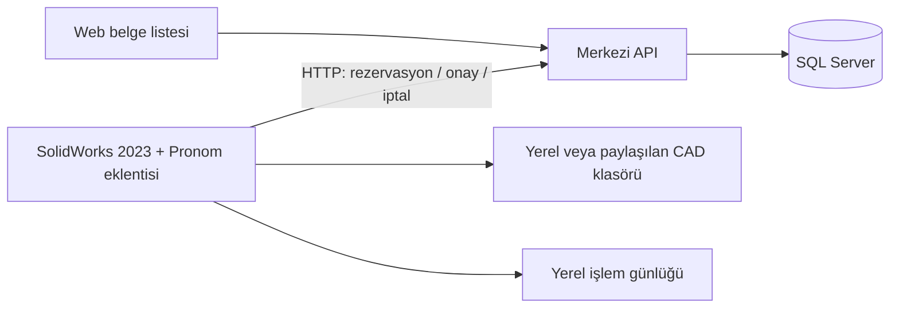

# Solidworks Co-Pilot

### SolidWorks için merkezi dosya numaralandırma ve kayıt takibi

Solidworks Co-Pilot, bir SolidWorks 2023 eklentisi, merkezi API ve web uygulamasıdır. Parça ve montaj dosyalarına ortak bir numara dizisinden ad verir; başarılı kayıtları tek bir web ekranında listeler.

Amaç, küçük bir ekipte farklı bilgisayarlardan oluşturulan dosyaları tutarlı biçimde adlandırmak ve kayıt sonuçlarını kolayca takip etmektir. Kullanıcı modelini SolidWorks içinde kaydeder; numaralandırma ve merkezi kayıt işlemlerini uygulama yürütür.

**Güncel sürüm:** Kaydet27 · `2026.10.22.1`

**Hedef ortam:** Windows x64 · SolidWorks 2023 · SQL Server 2022

> Bu depo otomatik numaralandırma ve kayıt takibi uygulamasının kaynaklarını içerir. Yapay zekâ ile model düzenleme, teknik resim üretimi veya satın alma/BOM hazırlayan ayrı Copilot ürünü bu deponun kapsamına dahil değildir.

## Neler yapar?

| İşlem | Uygulamanın davranışı |
| --- | --- |
| Yeni parça kaydı | `P00001.SLDPRT` biçiminde merkezi numara verir. |
| Yeni montaj kaydı | `M00001.SLDASM` biçiminde merkezi numara verir. |
| Normal kaydet / Ctrl+S | Mevcut adı korur; yeni bir web kaydı oluşturmaz. |
| Yeni dosya oluşturan Farklı Kaydet | Yeni dosya için ayrı numaralandırma işlemi yürütür. |
| Bağımsız Yap | Seçilen bileşeni yeni adla kaydeder ve montaj referansının yeni dosyaya geçmesini sağlar. |
| DXF dışa aktarma | Kaydedilmiş kaynak parçayla aynı temel adı kullanır; ayrı numara veya web kaydı oluşturmaz. |
| Özel adla bağımsız kayıt | Otomatik numara rezervasyonu iptal edilerek özel adlı dosya korunur. |
| Bağlantı kesintisi | İşlem kimliğini ve yerel günlüğü korur; merkezi sonucun sonradan toparlanmasını destekler. |

Web arayüzü belge arama, parça/montaj filtreleme, sayfalama ve **Türkiye saatiyle (TSİ)** tarih gösterimi sunar. Kurulum paketi merkezde ayrıca hazırlandığında istemciler güncel setup dosyasını web üzerindeki **Eklentiyi indir** bağlantısından alabilir.

## Nasıl çalışır?



API ve SQL Server merkez bilgisayarda, eklenti ise SolidWorks kullanılan bilgisayarlarda çalışır. API dosya numaralarını ve kayıt durumlarını yönetir; **CAD dosyalarını sunucuya yükleyen veya senkronize eden bir dosya deposu değildir.** Dosyaların konumunu kullanıcı belirler.

Kayıt süreci sabit bir işlem kimliğiyle rezervasyon, onay veya iptal aşamalarından geçer. Sonuç belirsizse aynı kimlik korunur. Toparlama araçları merkezi sonucu tamamlamak için kullanılır.

## Kurulum ve kullanım

### Kullanıcı bilgisayarı

1. SolidWorks 2023 kurulu olmalıdır.
2. SolidWorks kapalıyken merkezin sağladığı güncel Pronom setup paketini çalıştırın. Paket hem ilk kurulumu hem de desteklenen önceki sürümlerden güncellemeyi içerir.
3. Kurulumda merkez API adresini doğrulayın; yerel ağdaki istemciler merkezin erişilebilir adresini kullanmalıdır.
4. SolidWorks açıldığında Pronom eklentisinin etkin olduğunu kontrol edin.
5. Parça veya montajı normal kayıt akışıyla kaydedin; sonucu web belge listesinde kontrol edin.

Derlenmiş setup dosyası bu kaynak deposuna eklenmemiştir. Aşağıdaki bölüm geliştirici tarafından yerel paket oluşturmayı açıklar.

### Kaynaklardan derleme

Gerekli araçlar:

- Windows x64 ve .NET SDK 10.
- .NET Framework 4.8 Developer Pack.
- Lisanslı SolidWorks 2023 kurulumu ve bu kurulumdan alınan API referansları.
- API'nin çalışması için SQL Server 2022 ve hazırlanmış uygulama şeması.

SolidWorks referans klasöründe şu üç dosya bulunmalıdır:

```text
SolidWorks.Interop.sldworks.dll
SolidWorks.Interop.swconst.dll
SolidWorks.Interop.swpublished.dll
```

Depo kökünde PowerShell ile:

```powershell
& .\outputs\kurulum\GitHubKaynakDerle.ps1 -SolidWorksApiKlasoru 'C:\SolidWorks-API-Referanslari'
```

Betik eklentiyi, pencere okuma yardımcısını ve setup uygulamasını derler; setup'ın kendi kontrollerini çalıştırır. Sonuç:

```text
work\github-build\bin\Etiket.Kurulum\release\Pronom.Kurulum.exe
```

Derleme betiği bilgisayara eklenti kurmaz, COM kaydı yapmaz, API başlatmaz veya veritabanını değiştirmez. Geçici kaynaklar ve ikili dosyalar `work` altında kalır ve Git dışında tutulur.

SolidWorks DLL'leri bu depoda dağıtılmaz. Oluşturduğunuz yerel setup bu bağımlılıkları içerir; paketi başkalarıyla paylaşırken ilgili dağıtım haklarını değerlendirin.

### API'yi başlatma

Önce uygulama şeması hazırlanmış bir SQL veritabanı gerekir. `outputs/sql` klasörü şema ve geçiş betiklerini içerir. Betiklerin hedef veritabanlarını okuyup kendi ortamınıza göre belirleyin; tamamını mevcut veritabanında sırayla çalıştırmayın. Özellikle `006` temiz başlangıç işlemleri içindir; `007` hedef kontrolü gerektirir.

Hazır veritabanı için örnek yerel bağlantı:

```powershell
$env:ConnectionStrings__MerkeziVeritabani = 'Server=localhost;Initial Catalog=Pronom_Kullanim;Integrated Security=True;Encrypt=True;TrustServerCertificate=True'
dotnet run --project .\outputs\src\Etiket.Api --urls http://127.0.0.1:5082
```

Bu örnek Windows oturumuyla SQL bağlantısı kullanır. Gerçek sunucu/veritabanı adını ve sertifika ayarlarını kendi ortamınıza göre düzenleyin. Başlatma komutu veritabanı oluşturmaz veya sıfırlamaz.

- Web arayüzü: `http://127.0.0.1:5082`
- Veritabanını da kontrol eden sağlık adresi: `http://127.0.0.1:5082/api/health`

Diğer bilgisayarların erişimi için sunucunun dinleme adresi, istemci API adresi ve yerel ağ erişimi ayrıca yapılandırılır. Depodaki `192.0.2.10` adresi örnektir. Mevcut API'de kullanıcı kimlik doğrulaması bulunmaz; uygulama güvenilen yerel ağ kullanımı için geliştirilmiştir ve doğrudan internete açılacak bir servis olarak tasarlanmamıştır. **Kaynak deposunu herkese açmak, çalışan API'yi internete açmak anlamına gelmez.**

## Depo yapısı

```text
outputs/
├── src/
│   ├── Etiket.Api/                 # HTTP API ve web arayüzü
│   ├── Etiket.SolidWorks/          # SolidWorks kayıt olayları ve numaralandırma
│   ├── Etiket.PencereTanisi/       # Kayıt penceresi hedef okuma yardımcısı
│   ├── Etiket.Kurulum/             # İlk kurulum ve güncelleme arayüzü
│   └── Etiket.TestIstemcisi/        # Tanı/test istemcisi
├── tests/                          # Çekirdek, HTTP, pencere ve kurtarma kontrolleri
├── sql/                            # Şema ve geçiş betikleri
└── kurulum/                        # Derleme, dağıtım ve bakım araçları
```

`PronomSetupHazirla.ps1`, geliştirici ortamında tarihsel sürüm girdileriyle çalışan dağıtım betiğidir. Bu özel girdiler depoda bulunmaz. Temiz bir klondan derleme için `GitHubKaynakDerle.ps1` kullanın.

## Doğrulama durumu

Kaydet27 için geliştirici ortamında kaydedilen kontroller:

- 530 eklenti çekirdek kontrolü.
- 16 gerçek Windows kayıt penceresi girdi kontrolü.
- 34 kurtarma betiği kontrolü.
- Setup için 75 çekirdek kontrolü, beş eski sürümden ayrı ayrı 10 güncelleme/geri dönüş kontrolü ve 477 arayüz kontrolü.

Son saha kabulünde, daha önce sorun yaşanan bilgisayarda iki farklı parçayla toplam **dört Bağımsız Yap testi** başarılı oldu: dosya oluştu, montaj referansı değişti ve web listesinde tek kayıt görüldü. Kaydet27 merkez ve diğer istemcilere kuruldu. Bu sonuçlar test edilen ortamları kapsar; farklı SolidWorks sürümlerinde uyumluluk ayrıca doğrulanmalıdır.

## Paylaşım kapsamı

Bu depo Kaydet27'nin ayıklanmış kaynaklarından **yeni ve bağımsız bir Git geçmişiyle** paylaşım için hazırlanmıştır. Gerçek CAD dosyaları, veritabanı/yedekleri, işlem günlükleri, kişisel bilgisayar yolları, gerçek bağlantı ayarları, hesap bilgileri ve lisanslı ikili bağımlılıklar içermez.

Gerçek bağlantı ayarlarını ve yerel dosyalarınızı Git dışında tutun. Depoya şu aşamada bir açık kaynak lisansı eklenmemiştir; yeniden kullanım ve dağıtım izinleri için depo sahibiyle iletişime geçin.
